<p align="center">
  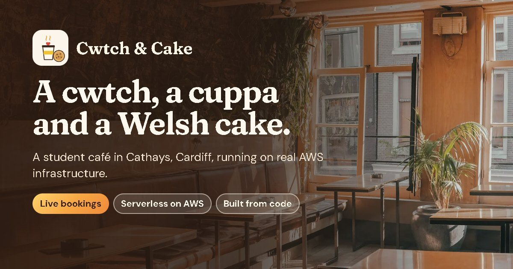
</p>

# Cwtch & Cake ☕🍪

A student café in Cathays, Cardiff, with a real website running on real AWS infrastructure. **The café is fictional. The cloud isn't:** live bookings that can't be double-booked, moderated reviews, a live menu with sold-out labels, an admin page behind MFA, alarms that email, a dashboard, and every piece of it built from code.

**Live site: https://d37nt89jw5nszl.cloudfront.net**

[](https://github.com/LukeM871/cwtch-and-cake/actions/workflows/deploy.yml)  -2ea043) 

> *Cwtch* (rhymes with "butch") is Welsh for a cuddle, or a cosy little nook. Cwtch & Cake is a fictional business, built as a portfolio project. Please don't go looking for it in the rain.

<p align="center">
  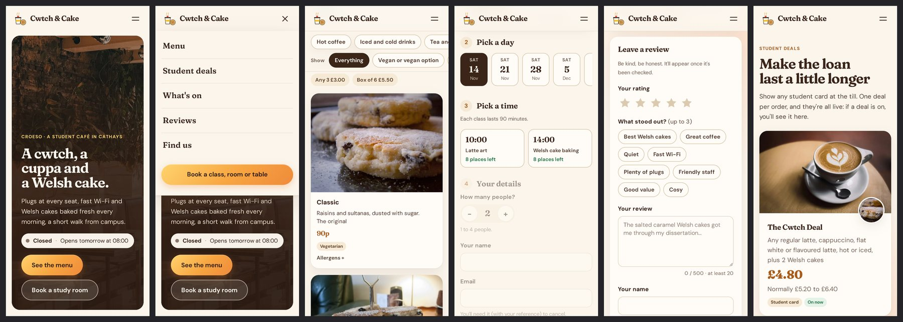
</p>

## What it does

| For students | For the café (admin page) |
|---|---|
| Browse the **live menu**: sold-out items are labelled, with vegan, vegetarian and gluten-free filters | **Sign in with Amazon Cognito**, MFA required (nobody can sign up) |
| **Book** a Saturday class, a study room or the big society table, with live availability | **Moderate reviews**: approve, reject or delete (hold to delete) |
| **Cancel** with the booking reference and email | Mark items **sold out**, change prices, set the **busy status** |
| **Leave a review**, with a *Verified visit* badge if you add a real booking reference | See **today's bookings** |
| See whether the café is **open and how busy** it is, plus exam-season late opening | Sold-out labels **reset by themselves at 06:00** every morning |

The website is plain HTML, CSS and JavaScript modules: no framework, no build step, no cookies and no tracking. It has light and dark mode, works on any phone size, and scores 99 to 100 in Lighthouse on every page.

## Architecture

<p align="center">
  
</p>

1. **CloudFront** is the only way in. It serves the website from a **private S3 bucket**, adds strict security headers to every response, and sends `/api/*` to **API Gateway** with a secret header, so the API can't be called directly and skip CloudFront.
2. **API Gateway** (HTTP API) applies rate limits per route, checks the admin's Cognito token on `/api/admin/*`, and calls one of **8 Lambda functions** (Python 3.12 on arm64).
3. The Lambdas use **4 DynamoDB tables**: bookings, slots, reviews and the café (menu, deals, busy status). Each Lambda has its own IAM role that can only touch the rows it needs.
4. **EventBridge Scheduler** runs a daily 06:00 reset. **CloudWatch** keeps the logs and metrics, shows a dashboard, and has two alarms that email through **SNS**.
5. **Terraform** builds all of it (94 resources). **GitHub Actions** runs the tests, then deploys with short-lived credentials from OIDC. There are no AWS keys anywhere.

More detail: [docs/API.md](docs/API.md) (every endpoint) and [docs/SECURITY.md](docs/SECURITY.md) (the security design).

## The interesting bits

### 1. Two people can't book the last place at the same time
Every booking is **one DynamoDB transaction** with two steps. The first adds the party to the slot's counter, but only if it still fits (`booked <= capacity - party`). The second saves the booking, but only if that reference is new. If either condition fails, **neither step happens**. To test it, five societies tried to book the same table at the same moment: one got it, four got a polite "sorry, that slot has just been taken", and the table was never over-booked.

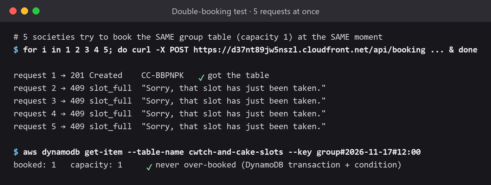

### 2. Each Lambda can only touch its own rows
Least privilege goes down to the row. The `get-status` Lambda can read **one row** of the café table (`pk = status`) and nothing else. It can't read the menu, can't write, and can't see the bookings table. This uses the `dynamodb:LeadingKeys` IAM condition, and it was checked with the IAM policy simulator and with real calls.

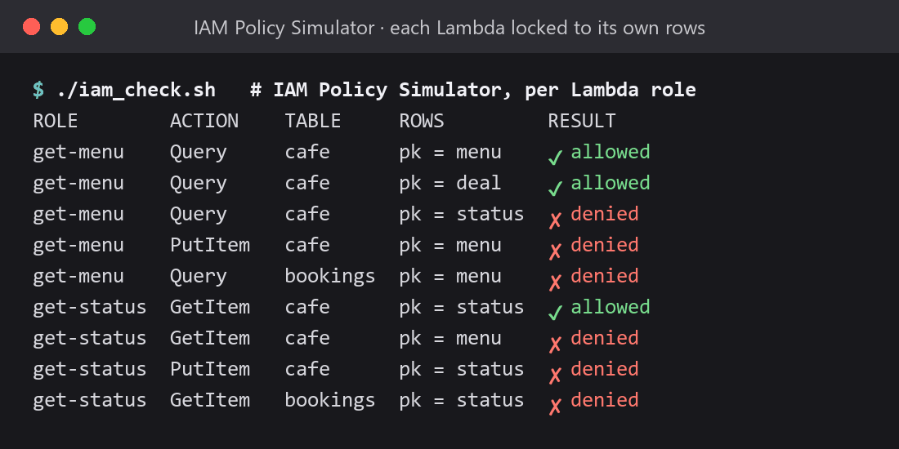

### 3. No AWS keys, anywhere
GitHub Actions gets **temporary credentials through OIDC**. The deploy role trusts only this repo's `main` branch, using GitHub's immutable repo and owner IDs, and it can only upload the site, update the 8 Lambdas' code and clear the CloudFront cache. There are no access keys in GitHub, in the code or on a laptop.

### 4. Reviews: a word filter, then a human
Reviews go through validation and a word filter. The filter list is stored **as SHA-256 hashes**, so the repo doesn't contain a list of slurs. Every review then waits in the admin's queue. Adding a booking reference and its email earns a *Verified visit* badge. Approving a review and updating the average rating happen in **one transaction**, so the average can never disagree with the reviews shown, and a daily recount at 06:00 repairs it if anything drifts. An **Amazon Comprehend toxicity check** is built and tested, but switched off: the AWS account is on the Free plan, which doesn't include Comprehend.

### 5. A live menu that's cheap to serve
The menu, deals and busy status live in DynamoDB, so the admin can mark something sold out from a phone and it shows on the site without a redeploy. CloudFront caches API responses at the edge: the menu and reviews for up to 5 minutes, and the busy status and availability for 30 seconds. On a busy day, most requests are answered from the cache without running a Lambda.

### 6. Locked-down front end
There's a strict Content Security Policy with **no inline scripts or styles** anywhere. CI fails the build if one appears. The pages never use `innerHTML`: everything a visitor typed goes in as text. Bookings delete themselves 30 days after the booking date (DynamoDB TTL). The result is an **A+ (125/100) on Mozilla Observatory**.

### 7. Alarms that have actually gone off
There are two CloudWatch alarms: backend errors, and the 06:00 reset failing. Both were **tripped on purpose** against the live system and emailed, then cleared. The Lambdas count bookings, reviews and caught bots with the CloudWatch embedded metric format, which needs no extra permissions or API calls.

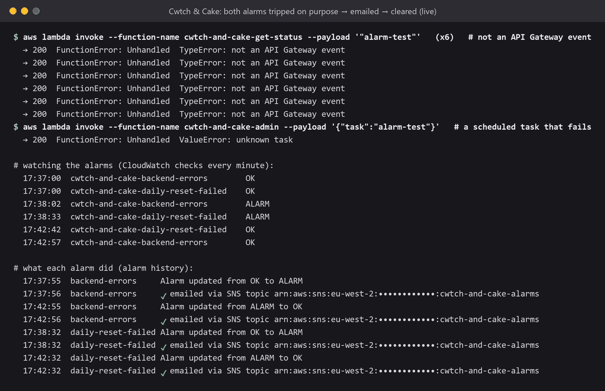

### 8. Rebuilt from nothing, then destroyed
Terraform **workspaces** can build a complete second copy of the whole system with its own names. As a disaster-recovery test, a copy was built from scratch (94 resources in 3 min 11 s), passed a 12-step smoke test, and was destroyed again, leaving nothing behind.

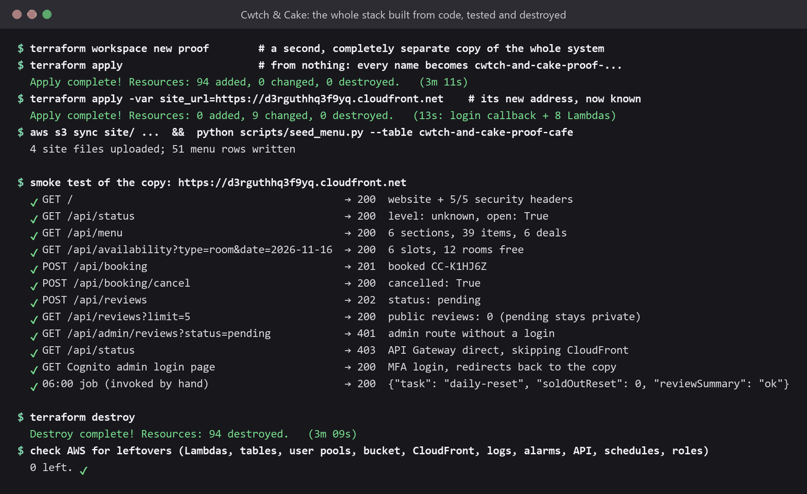

### 9. Tested
There are **1,148 tests**: 388 written by hand and 760 generated fuzz cases that throw odd input at every field. They run against mocked AWS (moto) with a frozen UK clock, so opening hours, exam season and UK summer time are tested properly. CI runs them on every push, before anything deploys.

## Screenshots

| | |
|---|---|
| 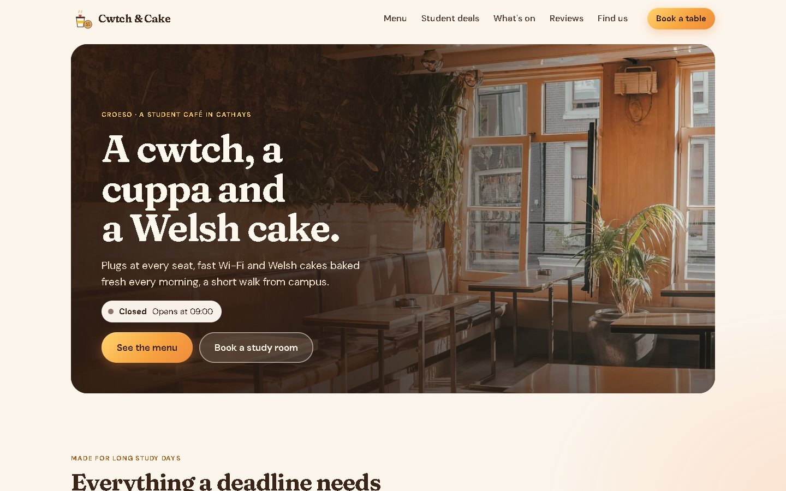 | 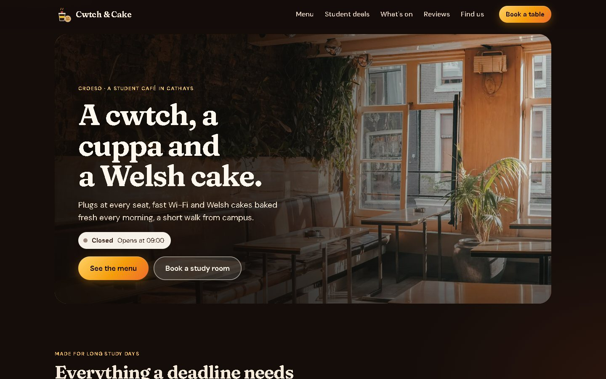 |
| Home page (light) | Home page (automatic dark mode) |
| 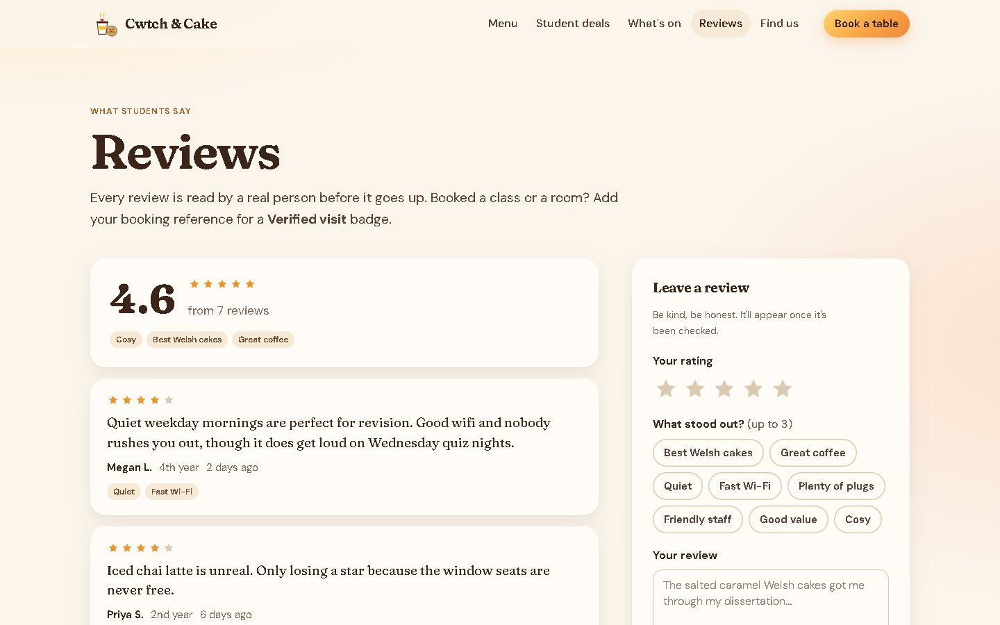 | 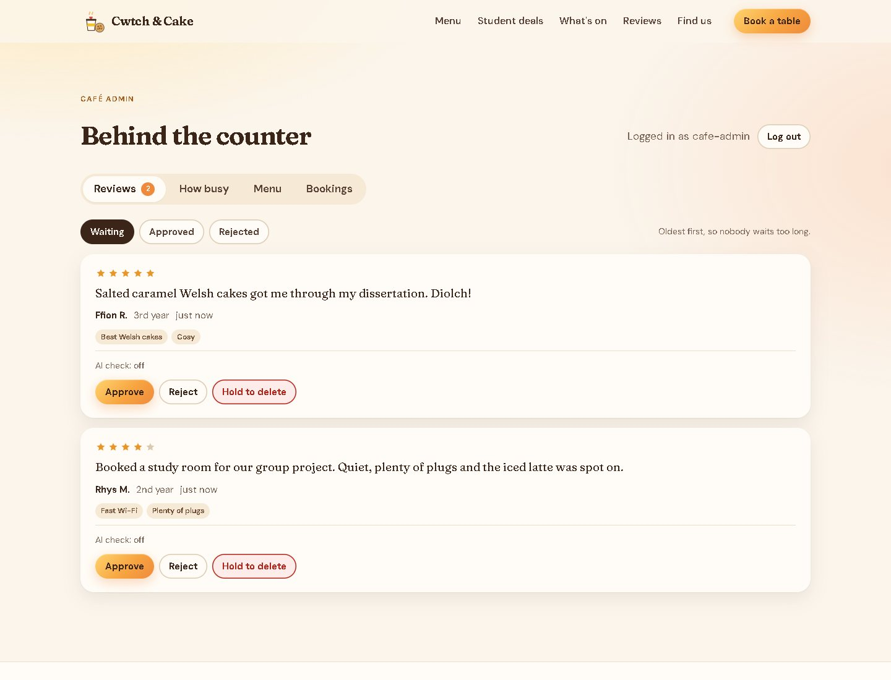 |
| Reviews and the review form | Admin: the moderation queue |
| 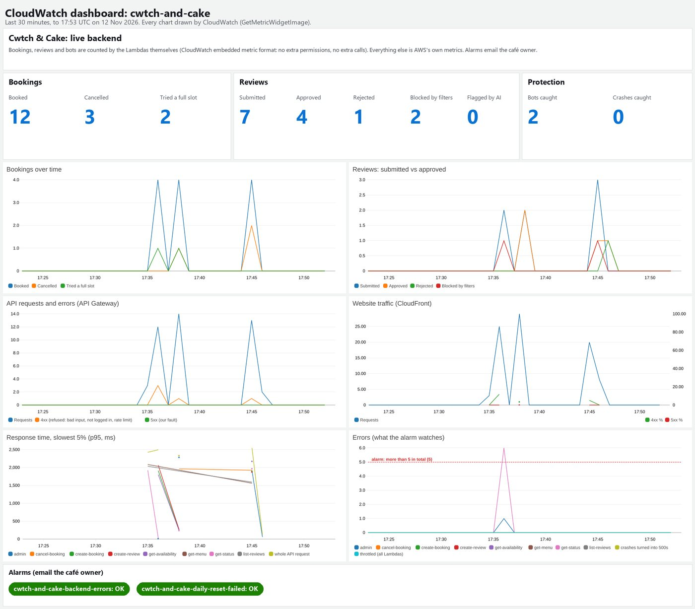 | 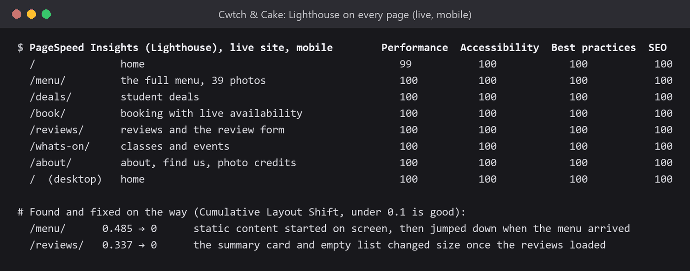 |
| CloudWatch dashboard | Lighthouse on every page (mobile) |
| 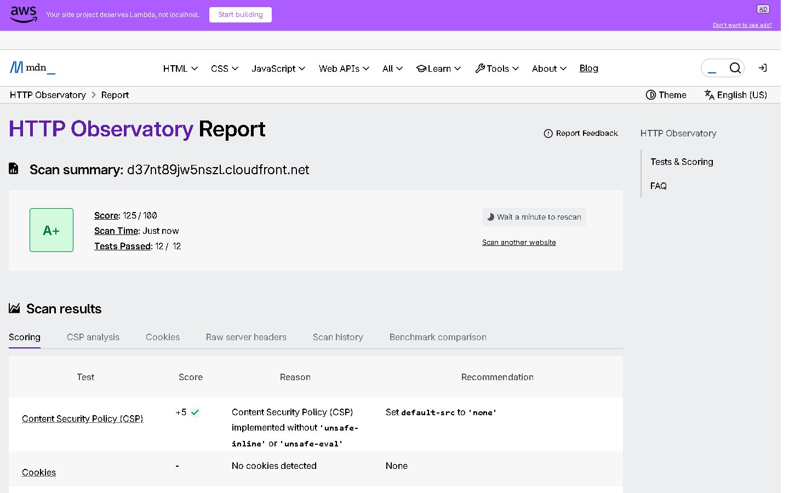 | 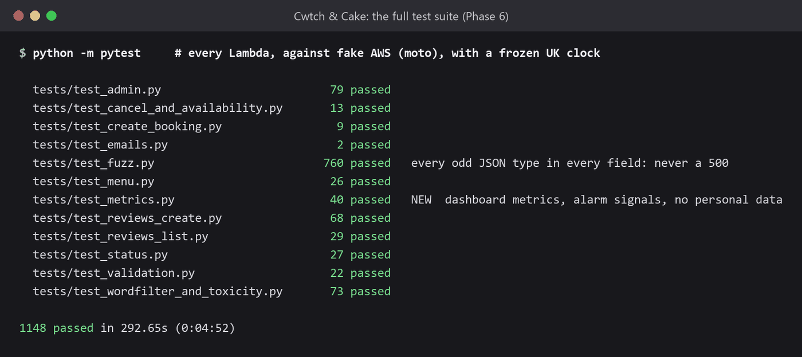 |
| Mozilla Observatory | The test suite |

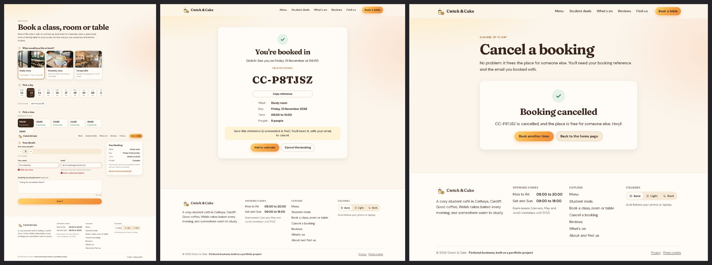

## Tech stack

| Area | What's used |
|---|---|
| Hosting | Amazon S3 (private) + CloudFront, a CloudFront Function for clean URLs, a response headers policy |
| API | API Gateway HTTP API with per-route throttling and a JWT authorizer |
| Compute | AWS Lambda, Python 3.12 on arm64 (Graviton), 8 functions sharing one small package |
| Data | DynamoDB (4 tables, on-demand), transactions, conditional writes, TTL, a GSI |
| Sign-in | Amazon Cognito: managed login, MFA, PKCE, an `admins` group |
| Scheduling | EventBridge Scheduler (06:00 Europe/London) |
| Monitoring | CloudWatch logs, embedded metric format, a dashboard, 2 alarms, SNS email |
| Email and AI | Amazon SES and Amazon Comprehend: built and tested, switched off for now |
| Infrastructure | Terraform (S3 remote state with native locking, workspaces) |
| CI/CD | GitHub Actions with OIDC |
| Front end | HTML, CSS and vanilla JavaScript modules; Fraunces and DM Sans fonts, self-hosted |
| Tests | pytest, moto, generated fuzz cases |

## Repo layout

```
site/                  the website (HTML, CSS, JS modules, fonts, images)
lambdas/src/           the 8 Lambda handlers + the shared "cwtch" package
lambdas/tests/         1,148 tests
infra/                 Terraform for everything (infra/bootstrap = the state bucket)
infra/functions/       the CloudFront Function (clean URLs)
scripts/               menu seeding, site deploy, photo build, local dev server
docs/                  API.md, SECURITY.md, the architecture diagram, screenshots
.github/workflows/     deploy.yml: checks, tests, deploy
```

## Run your own copy

You'll need an AWS account, the AWS CLI v2 (signed in, for example with `aws login`), Terraform 1.10 or newer, Python 3.12 and a GitHub repo.

1. **State bucket (once).** Follow [infra/bootstrap/README.md](infra/bootstrap/README.md), using your own bucket name. Put the same name in the `backend` block in `infra/versions.tf`.
2. **Build it.** In `infra/`, set `github_oidc_sub_prefix` to your repo's OIDC subject. Optionally, add `alarm_email = "you@example.com"` to `infra/alarm.auto.tfvars` (it's gitignored). Then run `terraform init` and `terraform apply`.
3. **Point the site at your copy.** Replace the CloudFront address in the `site_url` variable and the canonical links in `site/`. Put the Cognito domain and client ID from `terraform output` in `site/js/admin-config.js`.
4. **Load the menu:** `python scripts/seed_menu.py --dry-run`, then `python scripts/seed_menu.py`.
5. **Create the admin user** with the two `aws cognito-idp` commands in [docs/SECURITY.md](docs/SECURITY.md#the-admin-login-cognito). The first sign-in sets a password and MFA.
6. **Deploys.** Add the repo variables `AWS_DEPLOY_ROLE_ARN`, `SITE_BUCKET` and `CLOUDFRONT_DISTRIBUTION_ID` from `terraform output`. Every push to `main` then tests and deploys.

**Tests:** `cd lambdas`, `pip install -r requirements-dev.txt`, then `pytest`.<br>
**Local preview:** `python scripts/dev_server.py` serves `site/` on http://localhost:8765 with the real security headers, and passes `/api` calls to the live site.

## Cost

At portfolio traffic it runs in the AWS free tiers, apart from pennies. The CloudWatch metrics, alarms and dashboard were sized to fit the always-free limits exactly. A $5 budget alert is the safety net. There's no custom domain, which keeps it free.

## Credits

- Photos from [Unsplash](https://unsplash.com) and [Wikimedia Commons](https://commons.wikimedia.org), each credited on the site's [About page](https://d37nt89jw5nszl.cloudfront.net/about/#credits).
- Fonts: [Fraunces](https://github.com/undercasetype/Fraunces) and [DM Sans](https://github.com/googlefonts/dm-fonts), both under the SIL Open Font License.
- Cwtch & Cake, its logo and its menu are made up. Any resemblance to a real café in Cathays is a happy accident.
